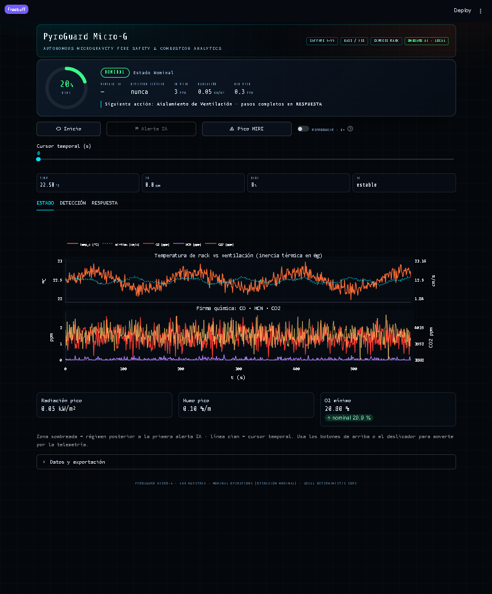
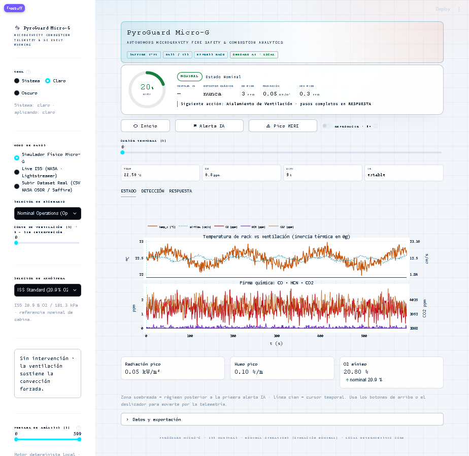

# PyroGuard Micro-G

[](https://pyrogaurdmicrog.streamlit.app)
[](https://github.com/gaelopr/pyroguard-micro-g/actions/workflows/tests.yml)
[](LICENSE)
[](https://www.python.org/downloads/)

### ▶️ [pyrogaurdmicrog.streamlit.app](https://pyrogaurdmicrog.streamlit.app)

**Detección temprana de incendio en microgravedad con telemetría química.**
Prototipo de análisis y alerta para un rack del US Lab de la ISS: demuestra por qué
los detectores convencionales (temperatura y humo) llegan tarde en 0 g, y cuánto
tiempo se gana mirando la firma química en su lugar.



La interfaz trae selector de tema **Sistema / Claro / Oscuro**: «Sistema» sigue la
preferencia del sistema operativo y la elección viaja en la URL (`?theme=light`), así que
se mantiene al recargar y se puede compartir.

<details><summary>Tema claro</summary>



</details>

## Qué hace

- **Simula** la física de una quema en microgravedad: inercia térmica, ausencia de
  convección natural, ventilación forzada y corte de ventilación.
- **Puntúa el riesgo** con un motor no supervisado (IsolationForest sobre tasas
  suavizadas) más un índice determinista, MIRI.
- **Compara** su alerta con un detector tradicional (temperatura > 45 °C o humo > 4 %/m)
  y cuantifica la ventaja en segundos.
- **Traduce** el diagnóstico a un protocolo de respuesta estilo flight rules.
- **Lee** telemetría real: el feed público de la ISS (Lightstreamer) y CSV externos
  con unidades crudas, validando rangos y negándose a analizar si falta lo mínimo.

## Arranque rápido

```bash
python -m pip install -r requirements.txt
streamlit run app.py --server.address 127.0.0.1
```

El bind a `127.0.0.1` es deliberado: por defecto Streamlit escucha en toda la red local.

Para servirlo fuera de tu equipo con un túnel temporal:

```bash
cloudflared tunnel --url http://127.0.0.1:8501
streamlit run app.py --server.address 127.0.0.1 \
  --server.enableCORS false --server.enableXsrfProtection false
```

Los dos overrides de CORS/XSRF solo hacen falta detrás de un proxy TLS: sin ellos la
app se queda en "Please wait". No están en el `config.toml` a propósito, para no
romper el despliegue en la nube.

## Despliegue en Streamlit Community Cloud

1. Entra en [share.streamlit.io](https://share.streamlit.io) con tu cuenta de GitHub.
2. **New app** → repositorio `pyroguard-micro-g`, rama `master`, main file `app.py`.
3. Opcional: en *Advanced settings* elige Python 3.12 y pega tu clave de NASA si algún
día añades canales privados (hoy no hace falta ninguna).
4. **Deploy**. La primera construcción tarda unos minutos.

Atajo con el formulario ya relleno:
<https://share.streamlit.io/deploy?repository=gaelopr/pyroguard-micro-g&branch=master&mainModule=app.py>

Si el build falla en una dependencia, relaja el pin correspondiente en
`requirements.txt` (`pandas==3.1.1` → `pandas>=3.0`): las versiones están fijadas a las
que se probaron, no a las únicas compatibles.

## Qué es dato y qué no

| Panel | Origen | Etiqueta en la app |
|---|---|---|
| Escenarios del simulador | `physics_simulator` (modelo físico) | simulación |
| Live ISS | feed público NASA JSC vía Lightstreamer | medido |
| Canales ausentes en Live | `physics_simulator` | inferido (trazo discontinuo) |
| CSV subido | tu fichero, normalizado | informe de mapeo |

El feed público expone 12 canales (atmósfera, térmico y soporte vital), entre ellos las
presiones parciales de O2 y CO2, de las que se derivan O2 en % y CO2 en ppm. No hay CO,
HCN, caudal de ventilación, humo ni radiación en abierto: la app **no puntúa MIRI sobre
datos reales** y lo dice en pantalla en lugar de rellenar los huecos.

## Datos de la NASA utilizados

Requisito del reto: al menos un recurso de datos de la NASA. Aquí hay **dos, uno en vivo
y otro histórico**, los dos públicos y sin credenciales.

| Recurso | Uso | Código |
|---|---|---|
| **ISSLIVE** — telemetría pública de NASA JSC vía Lightstreamer | 12 canales del US Lab y Node 3 (temperatura, presión, ppO2, ppCO2, ppN2, refrigerantes, aguas), en el modo LIVE | `iss_live.py` |
| **PSI** — Physical Sciences Informatics (`psi.nasa.gov`) | Tablas experimentales de **Saffire-I/II/III**, licencia CC0, con DOI, SHA-256 y descarga directa | `nasa_psi.py` |

- LIVE: `GET https://push.lightstreamer.com/lightstreamer/create_session.txt`, protocolo TLCP, adapter set `ISSLIVE`.
- PSI: metadatos en `/geode-py/ws/repo/investigations/<ACC>` y ficheros en `/geode-py/ws/studies/<ACC>/download?file=<nombre>`.
- Ambos se consultan en vivo desde el servidor de la app: no hay datos de NASA copiados al repositorio.
- Los canales que el modelo de incendio necesita y **no** existen en abierto (CO, HCN,
  caudal de ventilación, humo, radiación) se declaran en pantalla; la app no rellena huecos.

El feed de la ISS **no tiene histórico público**: es solo en vivo. Lo que sí es histórico
son los datos de experimento de PSI, que es lo que ofrece el modo «Histórico NASA».
Las series temporales crudas de Saffire (imágenes y telemetría de los sensores) pesan
entre 11 y 33 GB por experimento y quedan fuera del alcance de la app; lo que se descarga
es la matriz experimental del vuelo.

El modo «Histórico NASA» dibuja además la **comparativa del vuelo** con las cifras tal
como las publica NASA: cm quemados en 0-g por muestra (color = material) y, a la derecha,
%O2 de la cámara y tiempo de combustión. En Saffire-II son 4 muestras de silicona que se
apagan solas (~0 cm) frente a la tela SIBAL, que se consume entera (29 cm, 145 s y 115 s)
con el mismo %O2: lo que decide es el material. Los valores que NASA da como rango
(«22.1 to 22.0») o como dos cifras («5 cm & 0 (note 2)») no se convierten en un número:
se excluyen y se declaran bajo el gráfico.

El `demo_saffire_sintetico.csv` es sintético y su nombre lo dice.

## Cifras de referencia (reproducibles)

| Escenario | MIRI | Temp | CO | Nota |
|---|---|---|---|---|
| Operación nominal | 19,9 % | 23,0 °C | 2,8 ppm | NOMINAL |
| Pirólisis de cableado | 59,1 % | 26,7 °C | 88 ppm | HCN 12,4 ppm · detector tradicional ciego |
| Propagación por ventilación | 98,0 % | 30,8 °C | 192 ppm | IA 180 s vs tradicional 503 s → **+323 s** |
| Llama fría | 50,1 % | 23,4 °C | 60 ppm | PRE-IGNICIÓN, humo 0,21 %/m |
| Artemis + corte a 220 s | — | 25,3 °C | 54 ppm | CO 316 → 54 ppm, radiación 7,42 → 3,60 kW/m² |

La tabla son los **picos** de cada escenario. En la app el veredicto de la cabecera se calcula con
las muestras **hasta el cursor** —en t = 0 dice NOMINAL aunque el dataset acabe en CRÍTICO— y solo
los indicadores rotulados «sesión» (ventaja IA, detector clásico, MIRI pico) resumen el dataset completo.

## Validación del detector

Protocolo repetible en `validation.py` (30 repeticiones por caso, ruido de sensor distinto en
cada una). Detalle metodológico y tabla completa en [`docs/VALIDACION.md`](docs/VALIDACION.md).

```bash
python validation.py
```

| Clase | Casos | Detección IA | Detección clásica | Ventaja |
|---|---|---|---|---|
| Incendio (pirólisis, propagación, llama fría × ISS y AEA) | 180 corridas | **180/180** | 60/180 | +325 ± 7 s cuando el clásico llega a verlo |
| Sin fuego (nominal y corte de ventilación) | 90 corridas | **0/90** falsas alarmas | 0/90 | — |

AUC del MIRI pico separando incendio de no-incendio: **1.000** en este banco. El AUC alto es
esperable —los positivos son los regímenes que modela el simulador— así que lo que la tabla
demuestra es **robustez al ruido y cero falsos positivos en un transitorio de cabina**, no
rendimiento en vuelo real.

## Tests

```bash
python -m unittest discover -s tests -v
```

Se ejecuta también en cada push con GitHub Actions. 28 comprobaciones en unos 13 s, sin
dependencias nuevas: magnitudes de los cuatro escenarios, la ventaja de +323 s, el corte de
ventilación, las conversiones del mapeador, el rechazo de datasets incompletos, el protocolo
de validación y las cifras exactas que se dicen en la demo. Si un cambio mueve un número del
guion, la suite falla.

## Estructura

```
app.py                 UI Streamlit (Mission Control dark): 3 pestañas y modo LIVE
physics_simulator.py   Modelo físico: escenarios, atmósferas, corte de ventilación
anomaly_engine.py      Mapeo de CSV con unidades, IsolationForest, MIRI, protocolo
iss_live.py            Cliente TLCP propio + buffer de muestras reales
nasa_psi.py            Cliente de PSI (NASA) + parser de las tablas de Saffire
validation.py          Protocolo de validación: detección, falsos positivos, ventaja, AUC
demo_saffire_sintetico.csv   Dataset de demostración (sintético, unidades crudas)
tests/test_pyroguard.py     Regresión de las cifras del guion y de los escenarios
GUION_DEMO.md          Guion de presentación de 5 minutos
docs/                  Documentación: persona, diseño, arquitectura, física, IA, datos, LIVE
```

## Documentación

- [Checklist de entrega](ENTREGA.md) — enlaces, texto listo para el formulario y plan B
- [Guion del vídeo de 3 min](VIDEO_DEMO.md) — tomas, voz y edición
- [Persona y caso de uso](docs/PERSONA.md) — quién usa la app y qué decide
- [Decisiones de diseño](docs/DISENO.md) — tres ideas, qué se descartó, checklist UX y wireframe de las tres pantallas
- [Arquitectura y flujo de datos](docs/ARQUITECTURA.md)
- [Modelo físico](docs/MODELO_FISICO.md)
- [Motor de detección: IsolationForest y MIRI](docs/MOTOR_IA.md)
- [Mapeo y validación de CSV](docs/MAPEO_DATOS.md)
- [Modo LIVE: qué publica la NASA de verdad](docs/LIVE_ISS.md)
- [Validación del detector](docs/VALIDACION.md) — protocolo, tabla de resultados y qué no demuestra

## Uso de herramientas de IA (Super Intelligence)

Declaración exigida por el reglamento del NASA Space Apps Challenge:

- **Código y documentación**: escritos con asistencia de IA (agente de código Codebuff).
  Todo el código generado pasa por la suite de tests, por el protocolo de validación y por
  revisión manual; ninguna cifra de la interfaz se afirma sin un cálculo que la respalde.
- **Imágenes, audio y vídeo**: ninguno generado por IA. La interfaz es CSS y SVG escritos a
  mano y las capturas son de la app real. Si el vídeo de entrega usa voz sintética, hay que
  declararlo en su descripción y metadatos.
- **Datos**: no se usa IA generativa para producir telemetría. El CSV de demostración es
  sintético, lo dice su nombre y lo declara la app.

## Límites conocidos

- **No es un sistema certificado para vuelo.** Es un prototipo de apoyo a la decisión: no
  sustituye a los detectores certificados ni a las Flight Rules de la estación, y no ha
  pasado un proceso de certificación de software espacial (FMEA, DO-178, revisión de
  seguridad de vuelo).
- MIRI es un índice compuesto ponderado, determinista y auditable, **no** un modelo
  validado en vuelo.
- La telemetría de los escenarios es simulación física, no datos de misión.
- Sin canales de CO/HCN/humo en el feed público, el motor no puede puntuar datos reales.
- El modo LIVE depende de un servicio de terceros; si NASA no publica valores, la app
  lo declara y no inventa cifras.

## Créditos

Datos de referencia: campañas **Saffire I–VI** y **BASS** de la NASA. El feed LIVE usa
el servicio público `ISSLIVE` de NASA JSC vía Lightstreamer. Este proyecto no está
afiliado a la NASA.

## Licencia

MIT — ver [LICENSE](LICENSE).
